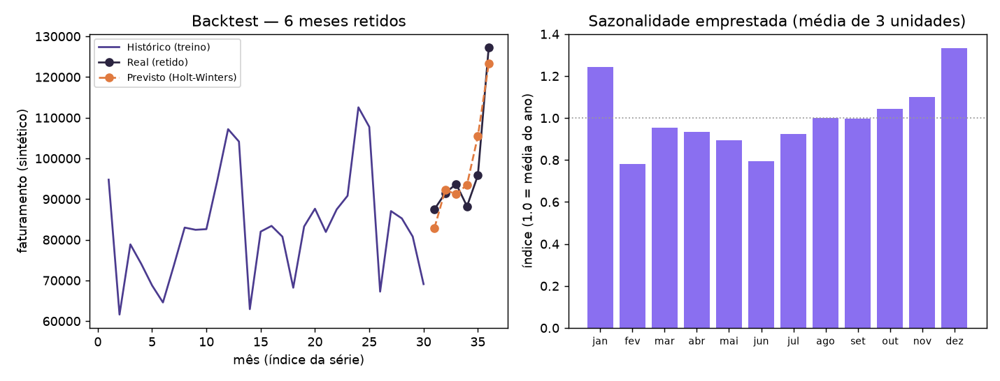

# previsao-vendas-sazonal

Previsão de faturamento mensal por **suavização exponencial tripla
(Holt-Winters multiplicativo)**, em Python puro — sem numpy/scipy/statsmodels
— com um mecanismo extra para o problema do **cold start**: como prever a
sazonalidade de uma unidade de negócio (loja, filial, produto) que ainda não
tem histórico suficiente pra estimar a própria.

Extraído e adaptado de um módulo de produção da **Mafê**, assistente de dados
por IA para redes de restaurantes, hoje em uso por clientes reais. Este
repositório contém só o algoritmo de previsão, sem nenhum dado ou credencial
de cliente — todos os números abaixo são **sintéticos**, gerados por
`demo.py`.

## O problema

Negócios sazonais (restaurante, varejo, turismo) têm um padrão de vendas que
se repete ano a ano (pico no fim de ano, vale em fevereiro/junho, etc.).
Prever bem exige separar três componentes da série — **nível**, **tendência**
e **sazonalidade** — e atualizá-los continuamente à medida que chega dado
novo. É isso que o Holt-Winters faz.

O problema prático que mais aparece numa rede com várias unidades: a unidade
**nova** (loja recém-aberta) não tem os ~24 meses de histórico necessários
pra estimar sazonalidade nenhuma com confiança. Esperar 2 anos pra ter uma
previsão decente não é opção.

## A solução: sazonalidade emprestada

Em vez de esperar, o módulo calcula a sazonalidade **típica do negócio** a
partir das unidades já maduras (cada uma normalizada pra tirar o efeito de
escala — sobra só o "formato" da curva ao longo do ano) e empresta esse
formato pra unidade nova, enquanto ajusta nível e tendência com o pouco de
dado real que ela já tem.

```python
from previsao import (
    holt_winters_multiplicativo, prever_holt_winters,
    calcular_indices_sazonais_emprestados, projetar_com_sazonal_emprestado,
)

# Unidade madura (>= 24 meses): previsão direta
modelo = holt_winters_multiplicativo(historico_36_meses)
previsto = prever_holt_winters(modelo, mes_alvo=12, passos_a_frente=2)

# Unidade nova (poucos meses): sazonalidade emprestada de unidades maduras
indices = calcular_indices_sazonais_emprestados([historico_loja_a, historico_loja_b])
previsoes = projetar_com_sazonal_emprestado(
    historico_loja_nova, indices, pedidos=[(7, 0), (8, 1), (9, 2)]
)
```

## Rodando o demo

```bash
pip install -r requirements.txt   # só matplotlib, pro gráfico
python demo.py
```

O script gera 3 séries sintéticas de unidades "maduras" (36 meses cada, com
sazonalidade de restaurante — alta em dez/jan, baixa em fev/jun — mais
tendência e ruído), faz um **backtest** (treina com 30 meses, prevê os 6
retidos) e simula uma unidade **nova** com só 6 meses de histórico.

```
=== Backtest (loja madura, 30 meses de treino -> 6 meses previstos) ===
  jul/2025: real R$  87,485.48  |  previsto R$  82,884.29
  ago/2025: real R$  91,465.46  |  previsto R$  92,254.61
  set/2025: real R$  93,710.08  |  previsto R$  91,163.29
  out/2025: real R$  88,225.86  |  previsto R$  93,544.36
  nov/2025: real R$  95,813.82  |  previsto R$ 105,455.67
  dez/2025: real R$ 127,329.75  |  previsto R$ 123,254.05
  MAPE no período retido: 4.7%
```



## Estrutura

```
previsao/
  holt_winters.py   # os 4 algoritmos (comentados, sem dependências externas)
demo.py              # dados sintéticos + backtest + gráfico
```

## Licença

MIT — ver [LICENSE](LICENSE).
